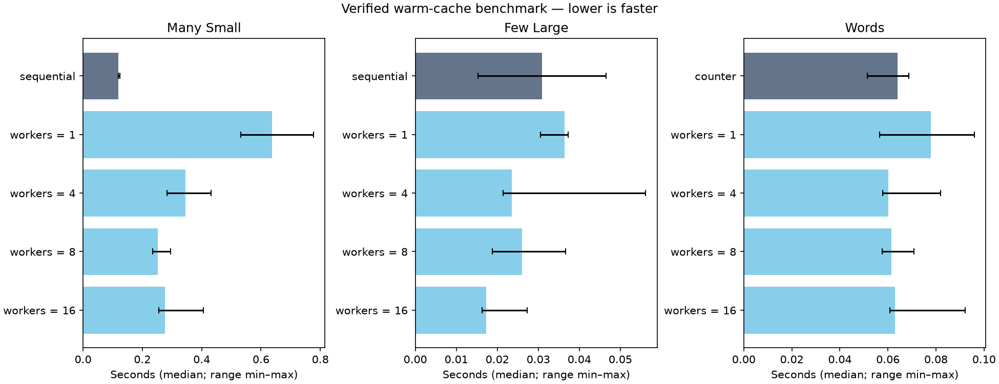

# Вимірювання швидкодії

```bash
make benchmark
```

Для більшого набору:

```bash
uv run --locked python -m scripts.benchmark \
  --small-files 1000 --large-files 4 --large-mib 32 --words 300000 --repeats 5
```

Кожний запуск створює `artifacts/benchmarks/<UTC>-<суфікс>/` із `results.json`,
`trials.csv` і `comparison.png`. Згенеровані вхідні файли й копії прибираються
після завершення або звичайної помилки; попередні результати залишаються.

## Що порівнюється

Типові набори: 300 файлів по 4 KiB, 3 файли по 16 MiB і текст на 150 000 слів.
Дані генеруються з seed `42`. Файли справді записуються, без sparse-файлів
чи клонування файлової системи.

Для файлів порівнюються послідовне копіювання та async із 1, 4, 8, 16 workers.
Обидва варіанти використовують блоки по 1 MiB і hard link для готової копії.
Імена унікальні, тому пошук суфіксів не вимірюється. Для тексту порівнюються
`Counter(tokenize(text))` і MapReduce з тією самою токенізацією, порціями по 2000 слів.

За замовчуванням кожна конфігурація має один прогрівальний запуск і три вимірювання.
Порядок варіантів перемішується відтворювано. `--warmups 0` вимикає прогрів;
`--repeats` має бути додатним. Підсумок містить медіану, мінімум, максимум,
throughput і відношення `median_baseline / median_variant`.

Таймер охоплює обхід і копіювання або токенізацію й підрахунок слів.
Для async сюди входить створення event loop. Генерація, перевірка результатів,
прибирання та побудова графіка виконуються поза таймером. Після кожного вимірювання
копії перевіряються за шляхами й SHA-256, а частоти — за `Counter`.
Неправильний результат зупиняє benchmark.

JSON зберігає параметри, ОС, Python, стан GIL, кількість CPU та SHA-256
вхідних даних, вимірюваних джерел і lockfile. `filesystem_location` містить лише
назву папки запуску відносно `--output`, без абсолютного шляху користувача.
Рядок `Результати:` у терміналі також показує лише цю назву папки.
CSV містить окремі вимірювання, включно з прогрівальними; у медіани вони не входять.

## Результат 27.10.2026

macOS 26.5.2 ARM64, CPython 3.14.6, GIL увімкнено, 16 логічних CPU.
Медіани в секундах для типових наборів:

| Варіант | 300 × 4 KiB | 3 × 16 MiB | 150 000 слів |
| --- | --- | --- | --- |
| Послідовно / Counter | 0,119613 | 0,030893 | 0,064016 |
| Async / MapReduce, 1 worker | 0,637617 | 0,036340 | 0,077837 |
| Async / MapReduce, 4 workers | 0,344624 | 0,023574 | 0,060187 |
| Async / MapReduce, 8 workers | 0,251829 | 0,026068 | 0,061535 |
| Async / MapReduce, 16 workers | 0,277075 | 0,017294 | 0,062949 |



Малі файли в цьому запуску швидше копіювалися послідовно. Для великих файлів
найнижча медіана була у 16 workers, але діапазони перекриваються:
0,015262–0,046514 с послідовно і 0,016296–0,027345 с для async.
MapReduce із 4/8/16 workers був близьким до `Counter`; діапазони теж перекриваються.
Трьох повторів недостатньо, щоб стверджувати стабільну перевагу.

Повні дані: [JSON](benchmarks/results.json), [CSV](benchmarks/trials.csv).
Це 60 запусків, із них 15 прогрівальних. Вимірювання виконано до додавання
JSON Schema: відтоді змінилися `common.py`, `uv.lock` і формат шляху в benchmark.
У збереженому JSON прибрано абсолютний шлях; вимірювання та SHA-256 залишені
з початкового запуску. Нові запуски не перезаписують ці файли.

## Як читати ці числа

Генерація й перевірка даних прогрівають кеш ОС навіть із `--warmups 0`.
`fsync` не виконується: вимірюється buffered I/O, а не гарантований запис
на фізичний носій. Мінімум і максимум показують розкид, а не довірчий інтервал.
На іншому диску або під іншим навантаженням результат може відрізнятися.
У CPython із GIL потоки також не гарантують прискорення підрахунку слів.
